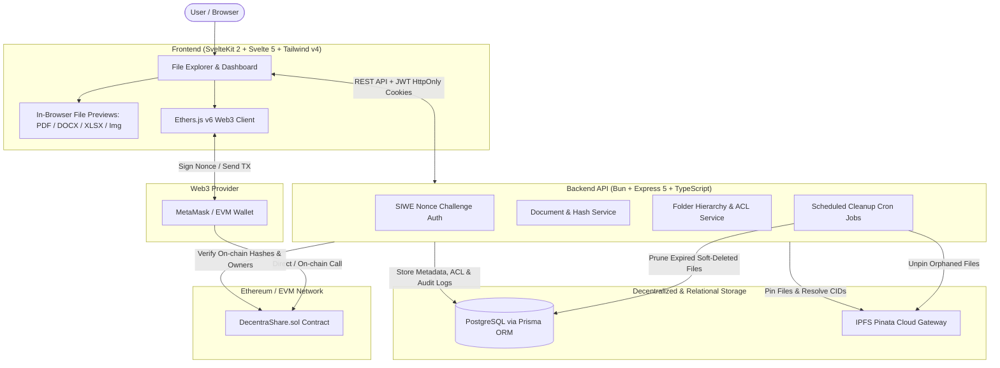
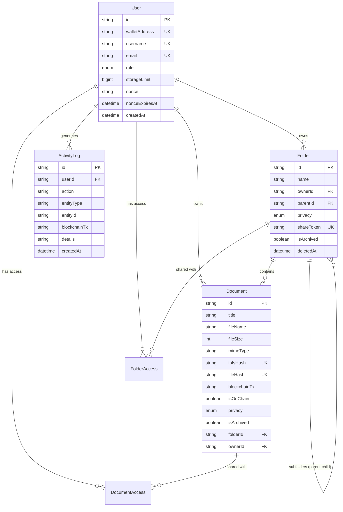

<div align="center">


# 🌐 DecentraShare

### Decentralized, Verifiable & Encrypted File Management on Ethereum & IPFS

A full-stack Web3 document management platform that couples decentralized IPFS storage with EVM smart contract records for cryptographic proof of ownership, immutable integrity verification, and fine-grained sharing control.

<p align="center">
  
  
  
  
  
  
  
  
  
  
  
</p>

</div>

---

## 📌 Table of Contents

- [Overview](#-overview)
- [Screenshots](#-screenshots)
- [System Architecture](#-system-architecture)
- [Tech Stack](#-tech-stack)
- [Core Features](#-core-features)
- [Smart Contract Specification](#-smart-contract-specification)
- [Database Schema](#-database-schema)
- [Project Structure](#-project-structure)
- [Getting Started](#-getting-started)
  - [Prerequisites](#prerequisites)
  - [Environment Variables](#environment-variables)
  - [Running with Docker Compose](#running-with-docker-compose)
  - [Manual Development Setup](#manual-development-setup)
- [Testing & Quality Assurance](#-testing--quality-assurance)
- [Security Considerations](#-security-considerations)
- [License](#-license)

---

## 🚀 Overview

Traditional cloud storage providers introduce centralized points of failure, unverified file mutations, and vendor lock-in. **DecentraShare** eliminates blind trust by anchoring document provenance directly to the blockchain while offloading payload distribution to the InterPlanetary File System (IPFS).

- **Verifiable Integrity:** Each uploaded document is fingerprinted client- and server-side via SHA-256 before pinning to IPFS.
- **On-Chain Proof of Ownership:** The cryptographic hash and IPFS CID are permanently registered on an EVM-compatible smart contract by the uploader's wallet address.
- **Enterprise-Grade File Management:** Intuitive folder nesting, permission delegation (`PRIVATE`, `LINK_ONLY`, `PUBLIC`, `SPECIFIC_USER`), in-browser document previews, and automated scheduled garbage collection.

---

## 📸 Screenshots

<table width="100%">
  <tr>
    <td width="50%" align="center" valign="top">
      <b>Landing Page</b><br/><br/>
      
    </td>
    <td width="50%" align="center" valign="top">
      <b>File Manager</b><br/><br/>
      
    </td>
  </tr>
  <tr>
    <td width="50%" align="center" valign="top">
      <b>Document Preview</b><br/><br/>
      
    </td>
    <td width="50%" align="center" valign="top">
      <b>Wallet Activity</b><br/><br/>
      
    </td>
  </tr>
  <tr>
    <td width="50%" align="center" valign="top">
      <b>MetaMask Transaction Request</b><br/><br/>
      
    </td>
    <td width="50%" align="center" valign="top">
      <b>Smart Contract on Etherscan</b><br/><br/>
      
    </td>
  </tr>
</table>

---

## 🏛️ System Architecture



---

## 🛠️ Tech Stack

| Layer | Technologies | Role & Purpose |
| :--- | :--- | :--- |
| **Frontend Framework** | **Svelte 5** (Runes syntax), **SvelteKit 2** | Reactive, high-performance UI and SSR routing |
| **Frontend Styling** | **Tailwind CSS v4**, Framer Motion | Modern utility-first styles, theme switching (Light/Dark) & fluid transitions |
| **Document Rendering** | `pdfjs-dist`, `mammoth`, `xlsx`, `heic2any` | Native in-browser rendering for PDF, DOCX, Spreadsheets, and HEIC |
| **Backend Runtime** | **Bun** | Ultra-fast JavaScript & TypeScript runtime |
| **API Framework** | **Express.js 5**, TypeScript | Structured REST endpoints, middleware pipelines, and validation |
| **Database & ORM** | **PostgreSQL**, **Prisma ORM** | Relational schema management, strict type-safety, and migrations |
| **Decentralized Storage** | **IPFS**, **Pinata Web3 SDK** | Content-addressed, resilient distributed file persistence |
| **Smart Contracts** | **Solidity 0.8.20**, **Hardhat 2**, Hardhat Ignition | On-chain file registry, batch recording, and integrity checks |
| **Web3 Client** | **Ethers.js v6**, MetaMask | EVM wallet connectivity, cryptographic challenge signing, contract calls |
| **Security & Utilities** | Helmet, Express Rate Limit, JWT, Multer, Winston, Archiver, Node-Cron | Defense-in-depth API protection, zip extraction, and background tasks |
| **DevOps & Containers** | **Docker**, **Docker Compose**, GitHub Actions | Consistent containerized environments and automated workflows |

---

## ✨ Core Features

1. **Web3 Nonce-Based Authentication (SIWE Pattern)**
   - Cryptographic challenge-response authentication via MetaMask.
   - Issues short-lived JWT access tokens and secure refresh tokens with automatic rotation.

2. **Decentralized Storage & Cryptographic Verification**
   - Direct integration with Pinata IPFS for content pinning.
   - SHA-256 hash generation for every file payload to guarantee data immutability.
   - Independent verification page to compare physical file hashes against on-chain ledger records.

3. **Dual-Mode Smart Contract Registration**
   - Individual upload registration (`recordFile`).
   - Batch registration (`recordFilesBatch`) up to 10 documents in a single transaction to minimize gas fees.

4. **Multi-Format In-Browser Preview**
   - Preview documents without downloading them:
     - **PDFs:** via Mozilla `pdfjs-dist`.
     - **Office Docs:** `.docx` via `mammoth`.
     - **Spreadsheets:** `.xlsx`, `.xls`, `.csv` via SheetJS.
     - **Images & Media:** Web-native images, videos, audio, and Apple `.heic` conversion.

5. **Granular Access Control & Sharing**
   - File and folder privacy levels: `PRIVATE`, `PUBLIC`, `LINK_ONLY`, and `SPECIFIC_USER`.
   - Granular permissions for folder collaborators: `VIEWER` or `EDITOR`.
   - Tokenized public access URLs for secure external sharing.

6. **Soft Deletion & Scheduled Trash Cleanup**
   - Trash system with one-click restore and permanent purge.
   - Configurable cron worker (`node-cron`) automatically cleans expired trash items and unpins orphaned files from IPFS.

7. **Storage Quotas & Administration**
   - Per-user storage quota enforcement calculated across all active IPFS documents.
   - Administrative dashboards for quota adjustments and global activity log monitoring.

---

## 📜 Smart Contract Specification

The smart contract [`DecentraShare.sol`](backend/contracts/DecentraShare.sol) acts as the immutable ledger for all documents:

```solidity
struct FileRecord {
    string ipfsHash;    // IPFS Content Identifier (CID)
    string fileName;    // Original file name
    string fileHash;    // SHA-256 checksum of payload
    address owner;      // EVM wallet address of the owner
    uint256 timestamp;  // Block timestamp of registration
}
```

### Key Functions

| Method | Access | Description |
| :--- | :--- | :--- |
| `recordFile(string _ipfsHash, string _fileName, string _fileHash)` | External | Records a single file on-chain. Validates content and CID uniqueness. |
| `recordFilesBatch(string[] _ipfsHashes, string[] _fileNames, string[] _fileHashes)` | External | Atomically records 1–10 files in a single transaction to optimize gas consumption. |
| `verifyOwner(string _ipfsHash)` | External View | Queries the contract and returns the owner wallet address registered for a given CID. |
| `checkFileExists(string _fileHash)` | External View | Checks whether a file with the given SHA-256 hash has already been registered on-chain. |

---

## 🗄️ Database Schema

Managed with Prisma ORM on PostgreSQL:



---

## 📂 Project Structure

```text
decentrashare/
├── backend/
│   ├── contracts/               # Solidity smart contracts (DecentraShare.sol)
│   ├── ignition/                # Hardhat Ignition deployment modules
│   ├── prisma/                  # Prisma schema and database migrations
│   ├── src/
│   │   ├── config/              # Environment, DB, Pinata, and cron configurations
│   │   ├── jobs/                # Scheduled background cleanup workers
│   │   ├── middlewares/         # Auth (JWT/SIWE), roles, Multer upload & error handlers
│   │   ├── modules/
│   │   │   ├── admin/           # Storage quotas & user administration
│   │   │   ├── auth/            # Nonce challenge, wallet verification, JWT issuing
│   │   │   ├── blockchain/      # Ethers contract interactions and hash verification
│   │   │   ├── document/        # Document CRUD, sharing permissions, previews
│   │   │   ├── folder/          # Nested folder hierarchy and ACL management
│   │   │   ├── pinata/          # IPFS pinning, unpinning, and gateway resolution
│   │   │   └── user/            # Profile and quota management
│   │   ├── utils/               # SHA-256 hash helpers, Web3 utilities, Winston logger
│   │   ├── app.ts               # Express application initialization
│   │   └── server.ts            # Server entrypoint
│   └── test/                    # Unit, integration, and whitebox test suites
├── frontend/
│   ├── src/
│   │   ├── lib/
│   │   │   ├── components/      # Svelte 5 components (FileGrid, Modals, Viewer, etc.)
│   │   │   ├── composables/     # Svelte 5 state runes (useSelection, useDelete, etc.)
│   │   │   ├── services/        # Web3 provider, API clients, storage services
│   │   │   └── utils/           # Theme controllers, validators, formatters
│   │   ├── routes/              # SvelteKit page routes (Auth, Explorer, Storage, Share)
│   │   └── static/              # Favicon, assets, and robots.txt
│   ├── svelte.config.js
│   ├── tailwind.config.ts
│   └── vite.config.ts
├── docs/
│   └── screenshots/             # Visual documentation assets
├── docker-compose.yml           # Multi-container orchestration (App & Postgres)
└── README.md
```

---

## 🚦 Getting Started

### Prerequisites

Ensure the following tools are installed on your machine:
- [Bun](https://bun.sh/) (v1.0+ recommended)
- [Node.js](https://nodejs.org/) (v20+ LTS) & `npm`
- [Docker](https://www.docker.com/) & Docker Compose
- [MetaMask](https://metamask.io/) browser extension
- Pinata account with API JWT credentials

---

### Environment Configuration

Salin template konfigurasi ke `.env` pada masing-masing direktori:

```bash
# Backend
cp backend/.env.example backend/.env

# Frontend
cp frontend/.env.example frontend/.env
```

Parameter konfigurasi utama yang diperlukan:
- **Database:** `DATABASE_URL` (koneksi PostgreSQL)
- **Authentication:** `JWT_SECRET`, `JWT_REFRESH_SECRET`
- **IPFS Storage:** `PINATA_JWT`, `PINATA_GATEWAY_URL`
- **Blockchain:** `RPC_URL`, `PRIVATE_KEY`, `CONTRACT_ADDRESS`
- **Frontend API:** `PUBLIC_API_BASE_URL`

---

### Running with Docker Compose

Untuk menjalankan PostgreSQL dan service pendukung via Docker:

```bash
# Clone the repository
git clone <repository-url>
cd decentrashare

# Start containerized services
docker compose up -d
```

---

### Manual Development Setup

#### Step 1: Start Database

Start PostgreSQL locally or run only the DB service via Docker:
```bash
docker compose up -d db
```

#### Step 2: Backend Setup

```bash
cd backend

# Install dependencies
bun install

# Run database migrations and generate Prisma client
bun run db:migrate
bun run db:generate

# Start development server
bun run dev
```
Backend API will be running on `http://localhost:3000`.

#### Step 3: Smart Contract Deployment (Optional Local Chain)

```bash
cd backend

# In a separate terminal, launch a local Hardhat node
bunx hardhat node

# Deploy DecentraShare contract locally
bunx hardhat ignition deploy ignition/modules/Counter.ts --network localhost
```
*Copy the deployed contract address into your `backend/.env` file.*

#### Step 4: Frontend Setup

```bash
cd frontend

# Install dependencies
bun install

# Start development server
bun run dev
```
Open your browser and navigate to `http://localhost:5173`.

---

## 🧪 Testing & Quality Assurance

The codebase includes comprehensive unit, integration, and whitebox testing:

```bash
# Backend unit tests
cd backend
bun run test:unit

# Whitebox tests
bun run test:whitebox

# Test coverage report
bun run test:coverage

# Smart contract tests
bunx hardhat test

# Frontend type-check & lint
cd ../frontend
bun run check
bun run lint
```

---

## 🛡️ Security Considerations

- **Integrity vs Confidentiality:** IPFS content addressing ensures tamper detection, but public gateway CIDs are discoverable if not guarded. DecentraShare uses application-level ACL tokens to protect sensitive download links.
- **Private Key Isolation:** Private keys never touch application servers. Contract transactions and message challenges are strictly executed client-side via MetaMask.
- **Replay Protection:** Challenge nonces are cryptographically unique, single-use, and expire within a strict time window to prevent signature replay attacks.
- **Input Sanitization & Rate Limiting:** All endpoints enforce strict payload schemas with Zod, parameterized SQL with Prisma, and aggressive IP rate limiting via Express.

---

## 📄 License

This project is licensed under the [MIT License](LICENSE).
