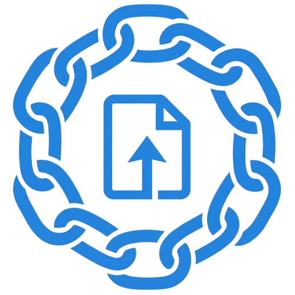
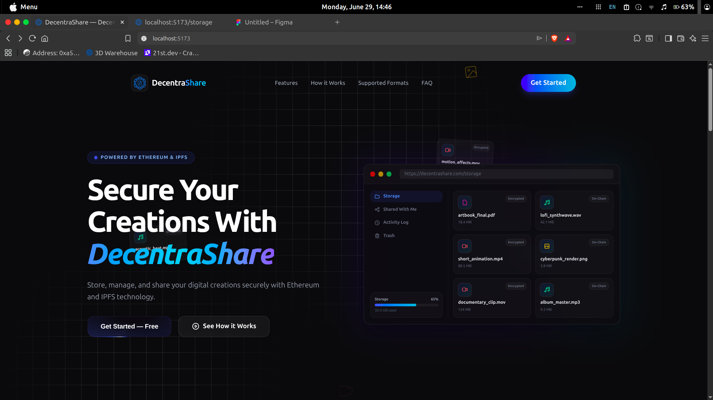
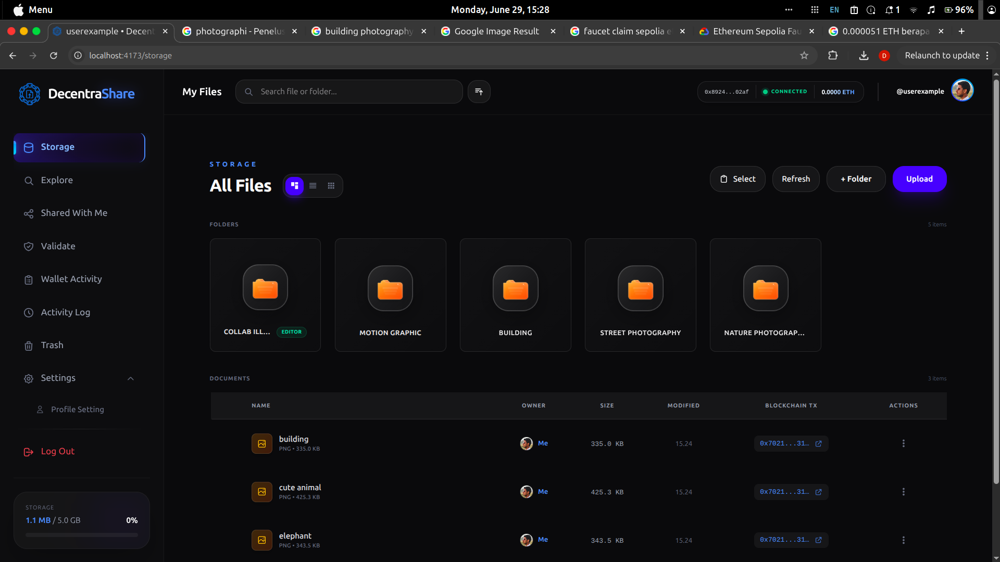
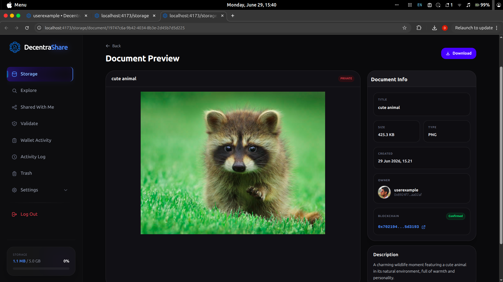
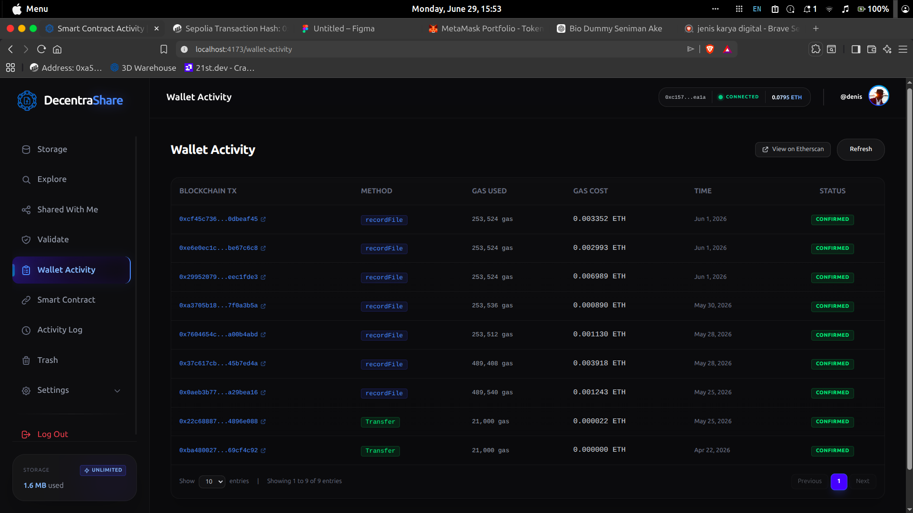
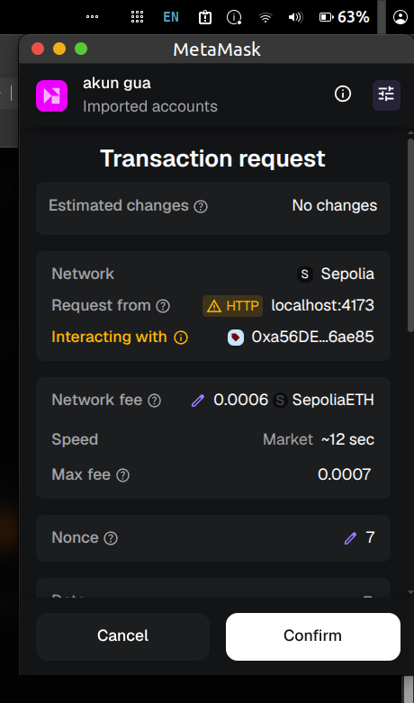
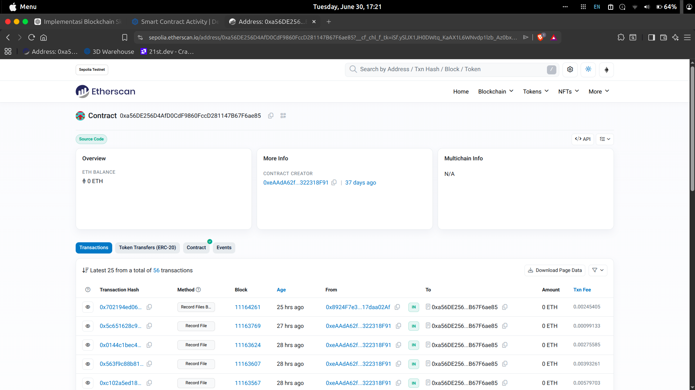
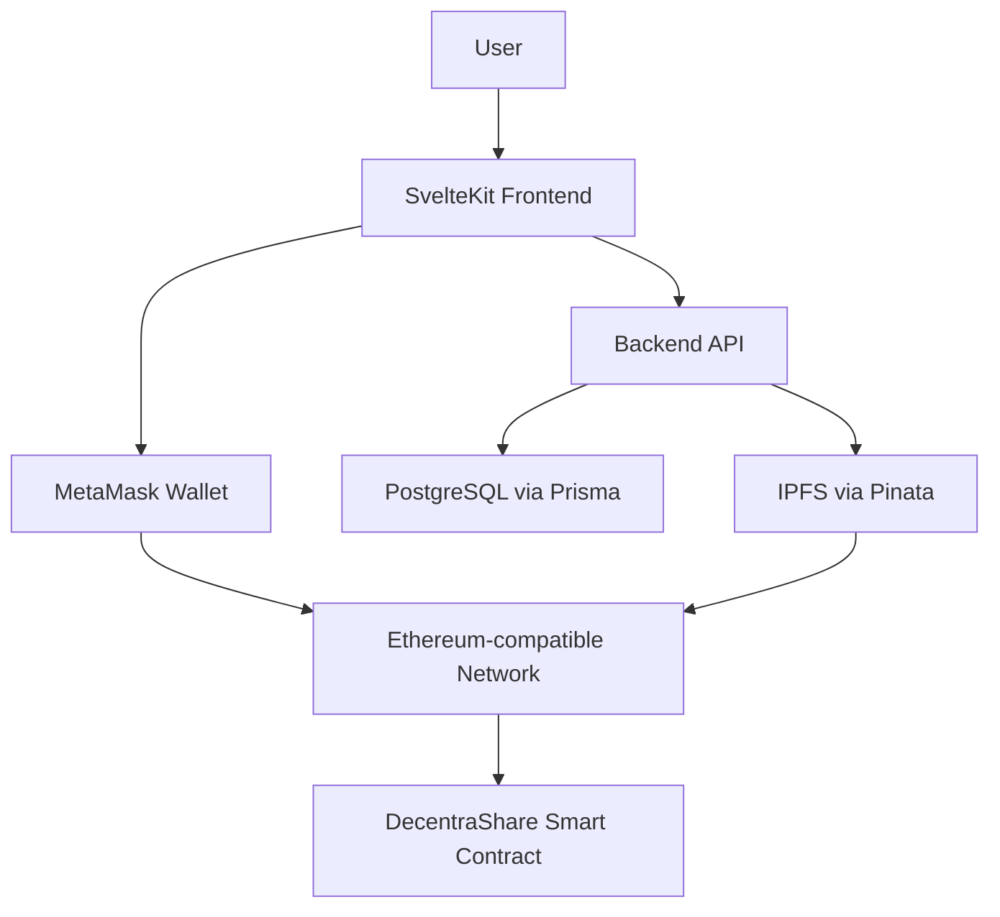

DecentraShare
Decentralized Digital File Sharing with Ethereum & IPFS
A Web3-powered file management platform that combines decentralized file storage with blockchain-based records to help verify file integrity and ownership.

  
  
  
  
  

Overview · Features · Screenshots · Architecture · Tech Stack · Getting Started

Overview
Traditional file-sharing platforms commonly depend on centralized storage and trust. DecentraShare explores an alternative approach by storing file content on the InterPlanetary File System (IPFS) and recording selected file metadata on an Ethereum-compatible blockchain.

The application combines a familiar file-management experience with decentralized infrastructure. Users can organize files and folders, configure sharing permissions, and use blockchain records to support independent verification of file integrity and ownership.
Project scope: DecentraShare is an academic software engineering project. Blockchain interactions may use a test network, depending on the configured deployment. It should not be considered a production storage or security service without further review and testing.

Key Features
- Wallet-based authentication — sign in through an EVM-compatible wallet using a nonce and signature verification flow.
- IPFS file storage — upload and pin files through the Pinata integration.
- File integrity verification — calculate a SHA-256 content hash and associate it with the file's IPFS CID.
- Blockchain records — record file references, content hashes, owner addresses, and timestamps through a Solidity smart contract.
- Batch registration — register up to 10 files in a single smart-contract transaction.
- File and folder management — organize content using nested folders, search, and file actions.
- Sharing permissions — support private, public, link-only, and specific-user access options, with viewer/editor access levels where configured.
- Trash and restore — soft-delete files and restore them from the trash.
- Activity history — review tracked actions and associated transaction references.
- Responsive interface — SvelteKit-based UI with light/dark theme support.
Screenshots
Add genuine screenshots captured from the running application to docs/screenshots/. The image paths below are ready to use once those files are added. Do not replace them with illustrative mockups if the goal is to show the actual application.

## Screenshots

### Landing Page

  

### File Manager

  

### Document Preview

  

### Wallet Activity

  

### MetaMask Transaction Request

  

### Smart Contract on Etherscan

  

How It Works
1. Authenticate — the user connects an EVM wallet and signs a nonce-based challenge.
2. Upload — the application calculates the file's SHA-256 hash and uploads the file to IPFS through Pinata.
3. Register — the application submits the file CID and metadata to the DecentraShare smart contract.
4. Manage — the user organizes files and folders and configures sharing options through the application.
5. Verify — the stored content hash and blockchain record can be checked against the file and its on-chain metadata.

Architecture
Layer	Technology	Responsibility
Frontend	SvelteKit 2, Svelte 5, TypeScript	User interface, file manager, wallet interactions
Styling	Tailwind CSS v4	Responsive layout and visual styling
Backend	Bun, Express.js 5, TypeScript	API, authentication, file and folder operations
Database	PostgreSQL, Prisma ORM	User data, file metadata, folders, permissions, activity logs
File storage	IPFS, Pinata	Store and retrieve file content using content identifiers
Blockchain	Solidity 0.8.20, Ethereum-compatible network	Record file metadata for verification
Web3 integration	Ethers.js, MetaMask	Wallet signatures and smart-contract transactions
Development & deployment	Docker, Docker Compose, Hardhat	Local services, contract development, and deployment workflows

Smart Contract
The DecentraShare.sol contract records file information on-chain, including the IPFS CID, file name, SHA-256 hash, owner wallet address, and block timestamp.

Core operations documented for the project include:
- recordFile(...) — register one file.
- recordFilesBatch(...) — register multiple files in one transaction, up to the configured batch limit.
- verifyOwner(...) — retrieve the recorded owner for a file CID.
- checkFileExists(...) — check whether a file hash has already been registered.
Blockchain transactions may require a network fee (gas). Use the network and contract address configured for your deployment.
Repository Structure
decentrashare/
├── backend/
│   ├── contracts/       # Solidity smart contracts
│   ├── ignition/        # Hardhat deployment modules
│   ├── prisma/          # Prisma schema and migrations
│   ├── src/
│   │   ├── modules/     # API domain modules
│   │   ├── middlewares/ # Authentication and request middleware
│   │   └── utils/       # Hashing and blockchain helpers
│   └── test/            # Backend tests
├── frontend/
│   ├── src/
│   │   ├── lib/         # Shared components and utilities
│   │   └── routes/      # Application routes
│   └── static/          # Static assets
├── docs/
│   └── screenshots/     # README UI screenshots
├── docker-compose.yml
└── README.md
Getting Started
Prerequisites
- Bun (recommended) or a compatible Node.js version
- Docker and Docker Compose, if using the containerized database setup
- An EVM-compatible wallet such as MetaMask
- A Pinata account and API credentials
- A configured blockchain RPC endpoint and deployed contract address
1. Clone the repository
git clone https://github.com/dimasprayogox/decentrashare.git
cd decentrashare
2. Configure environment variables
Create the environment files expected by each application (backend/.env and frontend/.env). Use the variable names documented in the project's current configuration or example environment files.

Typical settings include:
- PostgreSQL connection URL
- JWT signing secrets
- Pinata API credentials and gateway
- Blockchain RPC URL
- Deployed contract address
- Frontend backend API URL
Never commit real API keys, private keys, JWT secrets, or production credentials. Use local development values and a safe .env.example containing placeholders.
3. Start the database
If the project uses the provided Docker configuration, start its services with:
docker compose up -d
Otherwise, start PostgreSQL using your preferred local setup and ensure the connection string matches your environment.
4. Install dependencies
cd backend
bun install
Apply the database commands defined in the backend's package.json (for example, the project's migration and client-generation scripts), then start the backend using its configured development script.

In a separate terminal:
cd frontend
bun install
bun run dev
Open the local URL printed by the frontend development server. Confirm the exact scripts and required environment variables against the current repository before running the project.
Testing
The repository documentation describes backend, integration, and smart-contract test workflows. Run the scripts available in the current package.json files, for example:
cd backend
bun test
For smart-contract testing, use the Hardhat test command configured by the project. Test results can vary by environment and configuration; run the suite locally to confirm the current status.
Security Notes
- A SHA-256 hash helps detect content changes; it does not encrypt a file.
- IPFS content may be publicly retrievable by CID depending on pinning, gateway, and access configuration. Application-level sharing controls do not automatically make public IPFS content confidential.
- Never expose wallet private keys, API secrets, or JWT signing secrets in source control.
- Smart contracts and authentication flows require independent security review before production use.
- Use a test network for development unless a production deployment has been deliberately configured and reviewed.
Roadmap
Potential areas for further development:
- Improve automated test coverage and document reproducible test results.
- Add clearer verification details for each file, including the transaction reference.
- Improve accessibility and mobile file-management workflows.
- Document deployment configuration and operational monitoring.
Author
Dimas Prayogo
- GitHub: @dimasprayogox
- Repository: dimasprayogox/decentrashare

Built as an exploration of decentralized storage, blockchain verification, and full-stack application development.

